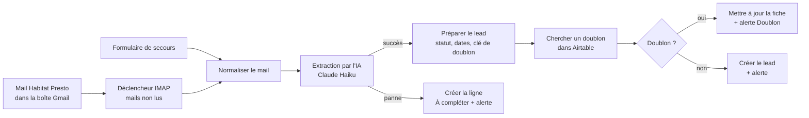

# Suivi des leads Habitat Presto : automatiser la saisie d'un mail de lead avec n8n, une IA et Airtable


Cas pratique réalisé pour une candidature en alternance « IA Builder » chez Month'immo : un workflow n8n qui lit un mail de lead, en extrait les informations avec une IA, les range dans un tableau de suivi, gère les doublons et les mails incomplets, et prévient le conducteur de travaux. Le tout avec des données fictives.


*Le workflow complet : 14 nœuds d'action et 5 notes de couleur sur le canevas, 100 % de nœuds natifs n8n, sans nœud de code.*

## En bref

| | |
|---|---|
| **Contexte** | Le pôle travaux de Month'immo reçoit jusqu'à 2 leads par jour d'une plateforme (Habitat Presto) sous forme de mail. Si personne ne les saisit à la main, ils n'existent nulle part et ne sont jamais suivis. |
| **Demande** | Un workflow qui lit un mail de lead, en extrait nom, téléphone, email, ville, type de travaux, budget et délai avec une IA, crée une ligne dans un tableau de suivi, gère au moins un cas d'erreur (mail incomplet, doublon), plus une note d'une page sur l'adoption et la mesure, une vidéo de 3 minutes et l'export du workflow. |
| **Solution** | n8n lit une boîte Gmail dédiée, Claude Haiku extrait 8 champs, des règles simples calculent le statut et repèrent les doublons, Airtable stocke les leads, Gmail alerte le conducteur de travaux. |
| **Résultat clé** | Aucun lead n'est perdu : un mail incomplet ou une panne de l'IA crée quand même une ligne « À compléter », et un client déjà connu met à jour sa fiche au lieu d'en créer une seconde. Un lead est traité en une trentaine de secondes après l'arrivée du mail. |
| **Livrables** | Export du workflow, tableau Airtable, note d'une page, script de la vidéo de 3 minutes, captures, jeu de leads de test. |
| **Limite assumée** | Données fictives, workflow non mis en production. Voir [Limites](#limites-et-passage-en-production). |

## Aperçu

**Un lead arrive par mail, une ligne apparaît dans le tableau, le conducteur est prévenu.** Les trois cas de la démonstration, tels qu'ils apparaissent dans Airtable et dans la boîte du conducteur :


*Le lead de Mme Claire D. est en « Nouveau », celui de M. Karim B. (ni téléphone ni email) en « À compléter ».*


*Chaque lead traité déclenche une alerte dont l'objet commence par [Nouveau lead], [À compléter] ou [Doublon].*

## Sommaire

1. [Le besoin et ce qui a été livré](#1-le-besoin-et-ce-qui-a-été-livré)
2. [Architecture](#2-architecture)
3. [Le workflow, nœud par nœud](#3-le-workflow-nœud-par-nœud)
4. [Règles métier](#4-règles-métier)
5. [Le tableau de suivi](#5-le-tableau-de-suivi)
6. [Cas testés](#6-cas-testés)
7. [Fiabilité de l'IA](#7-fiabilité-de-lia)
8. [Adoption et mesure](#8-adoption-et-mesure)
9. [Limites et passage en production](#limites-et-passage-en-production)
10. [Installation et exécution](#10-installation-et-exécution)
11. [Structure du dépôt](#11-structure-du-dépôt)
12. [Sécurité](#12-sécurité)
13. [Compétences démontrées](#13-compétences-démontrées)
14. [Auteur](#auteur)

## 1. Le besoin et ce qui a été livré

| Demande du mail | Réalisation | Où |
|---|---|---|
| Un workflow n8n (ou Make, ou du code) qui lit un mail de lead | Déclencheur Gmail (IMAP) sur les mails non lus dont l'objet contient « Habitat Presto », plus un formulaire de secours | [workflow](workflow/Leads_HabitatPresto_n8n.json) |
| Extraire nom, téléphone, email, ville, type de travaux, budget, délai avec une IA | Claude Haiku, 8 champs, température 0, consigne « n'invente rien » | nœud « Extraction IA » |
| Créer une ligne dans un tableau de suivi | Airtable, 16 champs | [section 5](#5-le-tableau-de-suivi) |
| Gérer au moins un cas d'erreur (incomplet, doublon) | Les deux, plus la panne de l'IA et les mails hors sujet ignorés | [section 6](#6-cas-testés) |
| Une note d'une page : adoption par le conducteur et mesure | Note de 6 actions d'adoption et 6 indicateurs | [note](note/Note_Adoption_Mesure_Cedric_Kouadio.pdf) |
| Captures ou export du workflow | Export JSON sans secret, 9 captures | [workflow](workflow), [captures](captures) |
| Une vidéo de 3 minutes maximum | Script minute par minute | [script](video/script_video_et_mail.txt) |

Le lead fictif de l'énoncé (Mme Claire D., Saint-Chamond, rénovation de salle de bain, budget de 8 000 à 12 000 euros, démarrage sous 3 mois) sert de cas nominal. Les autres leads de test sont dans [leads_test.txt](leads_test.txt).

## 2. Architecture



Quatre blocs, repérables par leur couleur sur le canevas : réception du lead, extraction par l'IA, règles métier et doublon, tableau de suivi et alerte. Un cinquième bloc, rouge, porte le cas d'erreur.

Principes suivis :

- **Tout se lit sur le schéma.** Aucun nœud de code : des formules courtes dans des nœuds « Edit Fields », lisibles par quelqu'un qui n'est pas développeur.
- **L'IA lit, les règles décident.** L'IA ne fait qu'extraire du texte. Le statut, la date de relance et le doublon sont calculés par des règles visibles, en dehors de l'IA.
- **Aucun lead n'est perdu.** Chaque chemin d'erreur crée une ligne et envoie une alerte.
- **Une entrée de secours.** Un formulaire permet de coller le texte d'un mail qui ne serait pas arrivé.

## 3. Le workflow, nœud par nœud

| Nœud | Rôle | Pourquoi |
|---|---|---|
| Mail Gmail Habitat Presto | Lit les mails non lus dont l'objet contient « Habitat Presto », les marque comme lus, se reconnecte toutes les 5 minutes | Lire le vrai mail sans saisie |
| Formulaire lead | Page web où coller le texte d'un mail | Entrée de secours |
| Normaliser le mail | Réunit les deux entrées dans un seul champ `mail` | Le reste ne dépend pas de l'entrée |
| Extraction IA (+ Claude Haiku) | Extrait nom, téléphone, email, ville, travaux, budget min et max, délai | Comprendre des formats de mail variés |
| Préparer le lead | Téléphone au format +33, email en minuscules, statut, dates de réception et de relance, clé de recherche | Règles simples et visibles |
| Chercher un doublon | Recherche dans Airtable le même email ou les 9 derniers chiffres du même téléphone | Éviter la deuxième ligne |
| Doublon ? | Aiguillage vers la mise à jour ou la création | Deux chemins clairs |
| Mettre à jour la fiche | Ajoute un commentaire, passe le nombre de contacts à +1, relance à demain | Garder l'historique du client |
| Créer le lead | Écrit la ligne dans Airtable | Rendre le lead visible |
| Alerte nouveau lead, Alerte doublon | Mail au conducteur avec de quoi rappeler le client | Pas besoin d'ouvrir le tableau |
| Créer le lead (sans IA), Alerte erreur IA | Branche de secours : ligne « À compléter » avec le mail brut | Aucun lead perdu si l'IA tombe |

## 4. Règles métier

| Règle | Valeur |
|---|---|
| Statut `Nouveau` | Le nom est connu **et** au moins un moyen de contact (email ou téléphone) |
| Statut `À compléter` | Dans tous les autres cas, avec la raison dans le commentaire |
| Téléphone | Chiffres uniquement, 9 derniers chiffres conservés, préfixe `+33` |
| Email | Mis en minuscules |
| Clé de doublon | Même email (en minuscules) **ou** mêmes 9 derniers chiffres du téléphone |
| Date de relance | Réception + 2 jours (+ 1 jour à chaque nouveau contact d'un client connu) |
| Doublon | Aucune nouvelle ligne : commentaire ajouté, nombre de contacts +1, relance à demain, alerte « Doublon » |

## 5. Le tableau de suivi

Table Airtable `Leads`, 16 champs : Nom, Telephone, Email, Ville, Type de travaux, Budget min, Budget max, Delai, Statut (Nouveau, À compléter, Appelé, RDV pris, Devis envoyé, Gagné, Perdu), Responsable, Date reception, Date de relance, Commentaire, Nb contacts, Source, et Statut modifie le (rempli automatiquement à chaque changement de statut).

Toutes les dates s'affichent au format français JJ/MM/AAAA, dans le tableau comme dans les alertes, et les heures sur 24 h en heure de Paris (fuseau fixé sur `Europe/Paris` dans Airtable et dans les paramètres du workflow).


Une vue **« À rappeler aujourd'hui »** liste les relances du jour ou en retard, hors leads gagnés ou perdus : c'est la vue que le conducteur consulte sur son téléphone.


*Le commentaire de la fiche de Mme Claire D. porte la trace du second contact, détecté comme doublon.*

## 6. Cas testés

Plus de 20 exécutions, dont 7 par le vrai déclencheur Gmail. Chaque lead est traité en une trentaine de secondes après l'arrivée du mail, l'essentiel de l'attente venant de la fréquence de lecture de la boîte.

| Cas | Résultat |
|---|---|
| Lead nominal de l'énoncé (Mme Claire D.), texte copié tel quel | Ligne « Nouveau », téléphone `+33612345678`, budget 8 000 à 12 000, alerte reçue |
| Ni téléphone ni email (M. Karim B.) | Ligne « À compléter », raison dans le commentaire, alerte « [À compléter] » |
| Budget « à définir » (famille Rossi) | Ligne « Nouveau », budget vide |
| Mail bruité : formule de politesse, autre ordre, signature (Mme Sophie M.) | Tous les champs retrouvés |
| Doublon par email et téléphone, écrits autrement | Aucune nouvelle ligne, fiche mise à jour, alerte « [Doublon] » |
| Doublon par téléphone seul (autre email, autre format) | Détecté |
| Doublon par email seul (en majuscules, autre téléphone) | Détecté |
| Mail dont l'objet ne contient pas « Habitat Presto » | Ignoré, aucune exécution |
| Entrée par le formulaire de secours | Traité comme un mail |
| Panne de l'IA (modèle volontairement invalide) | Ligne « À compléter » avec le mail brut, alerte d'erreur |


**Un défaut trouvé en testant :** après une longue inactivité, la connexion à la boîte mail pouvait se couper et un lead était manqué. Une reconnexion automatique toutes les 5 minutes (`forceReconnect`) a corrigé le problème, vérifié ensuite par un lead de test.

## 7. Fiabilité de l'IA

Trois protections, dans cet ordre :

1. **La consigne** interdit d'inventer et demande de laisser vide ce qui manque.
2. **Le réglage** : température à 0, pour des réponses stables d'une exécution à l'autre.
3. **Des règles de contrôle en dehors de l'IA** : sans nom ni moyen de contact, le lead passe en « À compléter » et le conducteur est prévenu.

Si le service d'IA ne répond pas, le nœud d'extraction réessaie deux fois puis bascule sur une branche de secours : le lead n'est pas perdu, il est à saisir à la main.

Coût : modèle le plus économique de la gamme, adapté à la lecture d'un mail court, pour un volume de deux leads par jour.

## 8. Adoption et mesure

La note d'une page ([PDF](note/Note_Adoption_Mesure_Cedric_Kouadio.pdf)) répond à la deuxième partie de la demande : comment faire adopter ce suivi par le conducteur de travaux, et comment mesurer que ça marche.

**Adoption.** Partir de son quotidien (une demi-heure avec lui), ne lui demander qu'un geste (changer le statut après chaque appel), passer par ses outils (alerte mail, vue mobile « À rappeler aujourd'hui »), former en dix minutes, revenir le voir à une semaine puis à trois semaines, lui montrer son bénéfice.

**Mesure, suivie chaque semaine directement dans Airtable :**

| Indicateur | Mesure | Objectif |
|---|---|---|
| Taux de capture | Leads dans le tableau, comparés aux leads reçus | 100 % |
| Rapidité du premier appel | Écart entre réception et statut « Appelé » (champ `Statut modifie le`) | Moins de 24 h ouvrées |
| Leads en retard | Leads encore « Nouveau » après leur date de relance | 0 |
| Fiches à compléter | Lignes « À compléter » corrigées sous 48 h | 100 % |
| Usage réel | Part des leads dont le conducteur a lui-même changé le statut | Plus de 90 % à trois semaines |
| Résultat commercial | Conversion lead, RDV, devis, gagné, mois après mois | En progression |

## Limites et passage en production

Ce workflow est une démonstration, pas un outil en production. Pour qu'un conducteur s'en serve réellement :

- une **adresse mail dédiée aux leads**, à la place de la boîte de test ;
- un **vrai destinataire** pour les alertes (aujourd'hui, une boîte de test joue le conducteur) ;
- un **hébergement qui reste allumé** (n8n tourne ici sur un ordinateur personnel) ;
- une **surveillance des erreurs** et des sauvegardes du tableau.

Limites connues :

- la comparaison du téléphone est prévue pour des **numéros français** ;
- le **changement d'heure** (passage à l'heure d'hiver, nuit du 24 au 25 octobre 2026) est sans effet : le fuseau `Europe/Paris` est fixé partout, et les dates de relance sont calculées en jours calendaires (une relance à +2 jours tombe le même jour local, 23 h 30 comprises, vérifié avec la bibliothèque de dates de n8n) ;
- le tableau n'est **pas relié** à un outil de gestion existant (Coda, facturation) ;
- le déclencheur dépend du format « mail non lu avec un objet contenant Habitat Presto » ; un changement d'objet côté plateforme l'empêcherait de partir ;
- les données sont fictives : le comportement sur de vrais mails (pièces jointes, formats exotiques) n'est pas démontré.

Évolutions possibles, par ordre de valeur : brancher sur la vraie adresse de leads et le vrai tableau, envoyer un accusé de réception automatique au client, étendre la logique aux devis du pôle travaux, suivre les délais de réponse.

## 10. Installation et exécution

Prérequis : n8n (2.x), un compte Airtable, un compte Gmail avec un mot de passe d'application (validation en deux étapes), une clé d'API Anthropic.

1. **Airtable.** Créer une base avec une table `Leads` portant les 16 champs de la [section 5](#5-le-tableau-de-suivi), ainsi qu'un jeton d'accès personnel (droits de lecture et d'écriture sur les enregistrements).
2. **Importer le workflow.** Dans n8n : *Workflows, Import from file*, puis choisir [Leads_HabitatPresto_n8n.json](workflow/Leads_HabitatPresto_n8n.json). L'export ne contient aucun identifiant : les nœuds demandent de relier leurs credentials.
3. **Créer les credentials :** IMAP Gmail (boîte qui reçoit les leads), SMTP Gmail (expéditeur des alertes), Airtable (jeton), Anthropic (clé d'API).
4. **Adapter** l'identifiant de base et de table Airtable dans les trois nœuds Airtable, ainsi que l'adresse du destinataire dans les trois nœuds d'alerte.
5. **Publier** le workflow, puis envoyer un mail d'objet `Nouveau lead Habitat Presto` à la boîte lue. Le texte du corps peut être l'un des leads de [leads_test.txt](leads_test.txt).

Pour tester sans Gmail, le formulaire de secours du workflow accepte le texte d'un mail collé à la main.

## 11. Structure du dépôt

```text
.
├── README.md
├── leads_test.txt                      5 leads fictifs : nominal, incomplet, doublon, sans budget, mail bruité
├── workflow/
│   └── Leads_HabitatPresto_n8n.json    export du workflow, sans secret
├── note/
│   ├── Note_Adoption_Mesure_Cedric_Kouadio.pdf   la note d'une page
│   └── build_note.py                   génération de la note
├── video/
│   └── script_video_et_mail.txt        script de la vidéo de 3 minutes
└── captures/                           10 captures d'écran réalisées sur ce projet
```

## 12. Sécurité

- Aucune clé, mot de passe ni jeton dans le dépôt : l'export du workflow ne contient que les références aux credentials.
- Les mots de passe d'application Google, la clé Anthropic et le jeton Airtable sont dédiés à ce cas pratique, et sont révoqués une fois l'entretien passé.
- Toutes les données (clients, téléphones, emails, adresses) sont fictives : adresses en `exemple.fr`, numéros inventés.

## 13. Compétences démontrées

| Compétence | Où on la voit |
|---|---|
| Automatisation de processus métier | Un mail devient une ligne de suivi et une alerte, sans intervention |
| Orchestration avec n8n | Déclencheur, aiguillage, sorties d'erreur, reconnexion automatique, 14 nœuds natifs |
| IA appliquée à un besoin concret | Extraction structurée d'un mail, protections contre les inventions, branche de secours en cas de panne |
| Qualité et tests | 10 cas testés, dont les erreurs, et un défaut réel trouvé puis corrigé |
| Conduite du changement | Note d'adoption, indicateurs de mesure, vue de relance |
| Esprit critique | Limites et passage en production dits explicitement |

## Auteur

**Cédric Kouadio**, étudiant en Master IA et Big Data à l'ESGI.

[GitHub](https://github.com/GomuGomuNo01)
