# Suivi des demandes Habitat Presto : un outil qui range chaque demande client et prévient le conducteur de travaux

Cas pratique réalisé pour une candidature en alternance « IA Builder » chez Month'immo. Quand une demande arrive d'Habitat Presto, l'outil la lit, la range dans un tableau de suivi et envoie un email au conducteur de travaux, sans que personne n'ait rien à recopier. Toutes les données sont fictives.

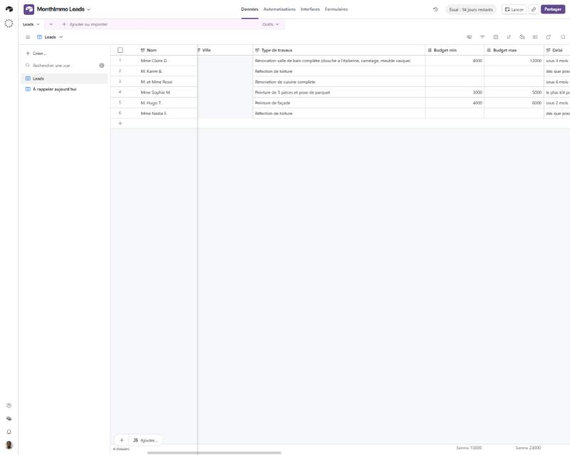

## En bref

| | |
|---|---|
| **Le problème** | Le pôle travaux reçoit jusqu'à 2 demandes par jour d'Habitat Presto, par email. Si personne ne les recopie à la main, elles n'existent nulle part et ne sont jamais rappelées. |
| **Ma solution** | Un outil qui lit chaque demande dès son arrivée, la range dans un tableau de suivi et prévient le conducteur de travaux par email. |
| **Ce que ça change** | Plus de recopie, plus de client oublié, et un seul geste pour le conducteur : indiquer où en est chaque client après son appel. |
| **Ce qui est livré** | L'outil, le tableau de suivi, une note d'une page sur l'adoption et la mesure, le script de la vidéo de démonstration et des captures d'écran. |
| **Ce qu'il faut savoir** | L'outil est une démonstration testée avec de fausses demandes. Il n'est pas encore branché sur de vraies données. |

## Sommaire

1. [Comment ça marche](#1-comment-ça-marche)
2. [Ce que voit le conducteur de travaux](#2-ce-que-voit-le-conducteur-de-travaux)
3. [Les situations que j'ai testées](#3-les-situations-que-jai-testées)
4. [Faire adopter l'outil et mesurer qu'il fonctionne](#4-faire-adopter-loutil-et-mesurer-quil-fonctionne)
5. [Avant une vraie mise en service](#5-avant-une-vraie-mise-en-service)
6. [Pour les curieux : le détail technique](#6-pour-les-curieux--le-détail-technique)
7. [Contenu du dépôt](#7-contenu-du-dépôt)
8. [Auteur](#auteur)

## 1. Comment ça marche

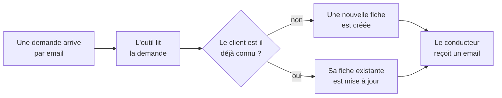

En quatre temps :

1. **La demande arrive** par email, comme aujourd'hui.
2. **L'outil la lit** et retrouve les informations utiles : nom, téléphone, email, ville, travaux, budget et délai souhaité.
3. **Il range le client** dans le tableau de suivi. Si le client a déjà écrit, il retrouve sa fiche au lieu d'en créer une deuxième : pas d'appel en double.
4. **Le conducteur est prévenu** par email, avec de quoi rappeler le client tout de suite.

Et si quelque chose ne va pas, aucun client n'est perdu :

- **Demande incomplète** (pas de téléphone ni d'email, par exemple) : la fiche est créée quand même, marquée « à compléter ».
- **L'outil de lecture ne répond pas** : la fiche est créée avec le message d'origine recopié dedans, et le conducteur est prévenu pour la remplir à la main.

## 2. Ce que voit le conducteur de travaux

**Le tableau de suivi.** Une ligne par client, avec ses informations, son état (nouveau, à compléter, appelé, rendez-vous pris, devis envoyé, gagné, perdu) et la date à laquelle le rappeler.

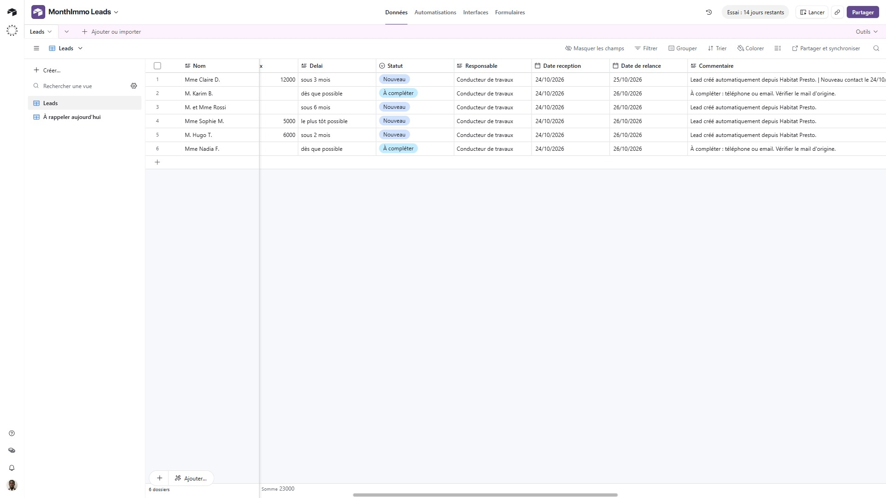

*Mme Claire D. est « Nouveau ». M. Karim B., dont la demande n'avait ni téléphone ni email, est « À compléter ».*

Toutes les dates sont au format français (JJ/MM/AAAA) et les heures sur 24 h, en heure de Paris.

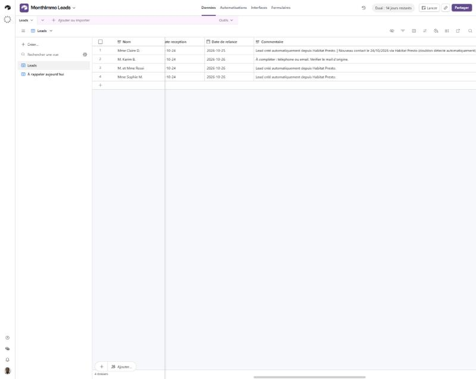

*Le commentaire de Mme Claire D. garde la trace de son deuxième contact.*

**Les emails d'alerte.** À chaque demande traitée, le conducteur reçoit un email dont l'objet dit tout de suite de quoi il s'agit : [Nouveau lead], [À compléter] ou [Doublon].

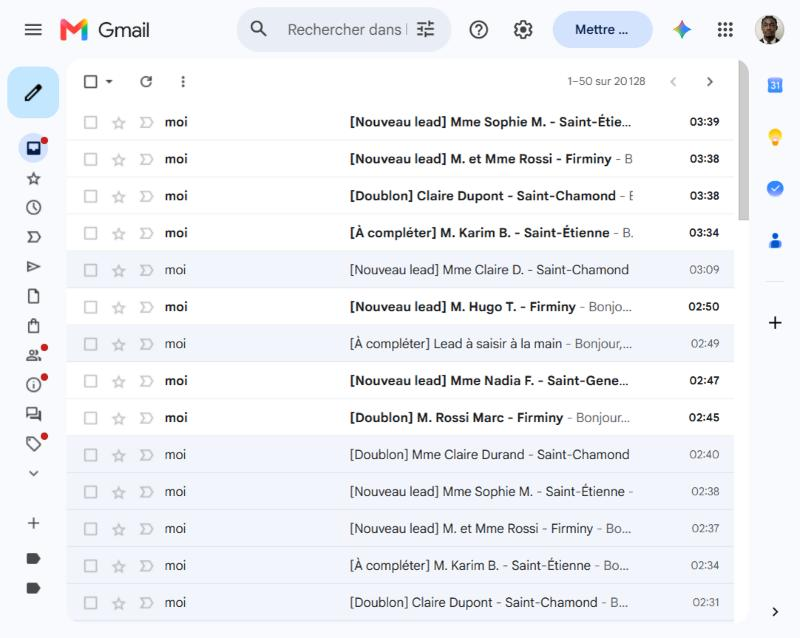

| Nouvelle demande complète | Demande à compléter | Client déjà connu |
|---|---|---|
| 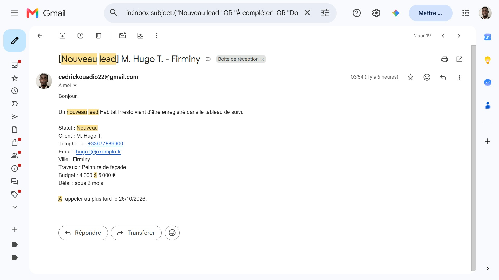 | 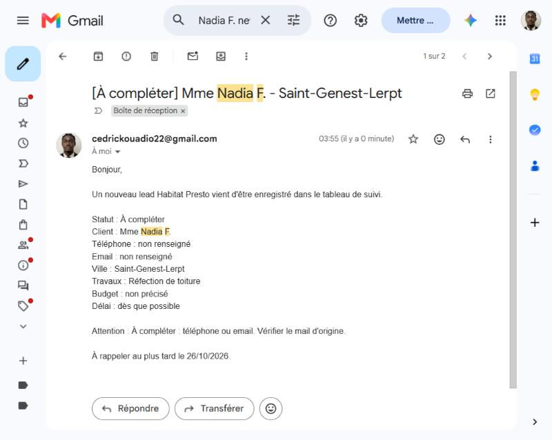 | 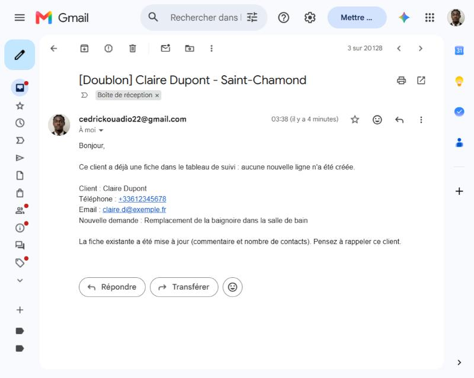 |

Une liste **« À rappeler aujourd'hui »** montre en un coup d'œil les clients à appeler ce jour ou en retard. Elle se consulte aussi sur téléphone.

## 3. Les situations que j'ai testées

Plus de vingt essais au total. Chaque demande est traitée en une trentaine de secondes après son arrivée.

| Situation | Ce qui se passe |
|---|---|
| Demande complète (celle de l'énoncé : Mme Claire D., salle de bain) | Fiche créée, état « Nouveau », email envoyé |
| Ni téléphone ni email | Fiche créée, état « À compléter », email qui le signale |
| Budget non précisé | Fiche créée sans budget, rien d'inventé |
| Message écrit de façon différente (politesse, autre ordre, signature) | Toutes les informations sont quand même retrouvées |
| Quatre demandes qui arrivent presque en même temps | Traitées une par une, dans l'ordre, sans qu'aucune ne soit perdue ni mélangée |
| Le même client qui réécrit (numéro et email écrits autrement) | Pas de nouvelle fiche : l'ancienne est mise à jour, le conducteur est prévenu |
| Même client reconnu seulement par son téléphone, ou seulement par son email | Reconnu aussi |
| Email sans rapport avec Habitat Presto | Ignoré |
| Le service de lecture est en panne | Fiche « À compléter » avec le message d'origine, email d'alerte |
| Une demande collée à la main dans le formulaire de secours | Traitée comme un email normal |

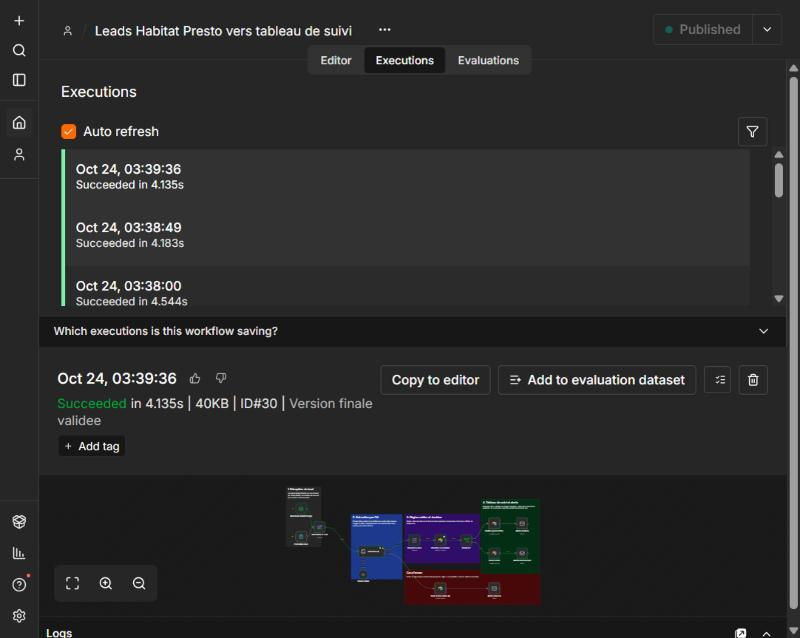

**Un deuxième défaut trouvé en testant :** quatre demandes envoyées d'un coup étaient traitées en même temps et pouvaient se mélanger (une fiche mise à jour avec les informations d'un autre client). L'outil traite maintenant les demandes une par une.

**Un défaut trouvé en testant :** après une longue période sans demande, la connexion à la boîte email pouvait se couper et une demande passait à côté. J'ai ajouté une reconnexion automatique toutes les 5 minutes, puis vérifié qu'une demande arrivait bien ensuite.

## 4. Faire adopter l'outil et mesurer qu'il fonctionne

La [note d'une page](note/Note_Adoption_Mesure_Cedric_Kouadio.pdf) répond aux deux questions du cas pratique en langage simple.

**Pour que le conducteur s'en serve**, je lui montre ce que l'outil lui enlève comme travail :

- il **gagne du temps** : plus de recopie (environ 5 minutes par demande, estimation à confirmer avec lui) ;
- il **n'oublie plus personne** : un email par demande et la liste « à rappeler aujourd'hui » ;
- il **rappelle mieux** : toutes les informations sous les yeux avant d'appeler ;
- il n'a **qu'un seul geste** à faire : indiquer où en est le client après son appel.

Je lui montre l'outil sur une vraie demande, il l'essaie lui-même, puis je reviens le voir à une semaine et à trois semaines pour corriger ce qui le gêne.

**Pour savoir si ça marche**, je vérifie chaque semaine quatre choses :

1. aucun client n'est oublié (chaque demande a sa fiche) ;
2. les clients sont rappelés en moins d'une journée de travail ;
3. le conducteur met lui-même à jour l'avancement de presque tous ses clients (9 sur 10 après trois semaines) ;
4. les devis et les ventes issus de ces demandes augmentent de mois en mois.

## 5. Avant une vraie mise en service

L'outil est une démonstration. Pour qu'un conducteur s'en serve au quotidien, il faudrait :

- une **adresse email dédiée** aux demandes, à la place de ma boîte de test ;
- le **vrai destinataire** des alertes (aujourd'hui, une boîte de test joue le conducteur) ;
- un **ordinateur ou un serveur toujours allumé** (l'outil tourne ici sur mon ordinateur) ;
- quelqu'un qui **surveille** son bon fonctionnement.

Ses limites actuelles :

- la reconnaissance d'un client par son téléphone est prévue pour des **numéros français** ;
- le tableau n'est **pas relié** à vos autres outils (Coda, facturation) ;
- l'outil repère les demandes grâce à l'objet de l'email (« Habitat Presto ») : si la plateforme le change, il faudra l'adapter ;
- il n'a été testé qu'avec de **fausses données** : le comportement sur de vrais messages (pièces jointes, formats inhabituels) n'est pas démontré ;
- le **changement d'heure** du 25 octobre 2026 est sans effet : toutes les heures sont réglées sur Paris et les dates de rappel sont comptées en jours.

Prochaines étapes possibles, de la plus utile à la moins urgente : brancher l'outil sur vos vraies adresses et votre vrai tableau, envoyer un accusé de réception automatique au client, étendre la même idée aux devis du pôle travaux, suivre les délais de réponse.

## 6. Pour les curieux : le détail technique

<details>
<summary><b>Voir les outils, les règles et l'installation</b></summary>

### Les outils utilisés

| Besoin | Outil |
|---|---|
| Enchaîner les étapes | n8n (15 étapes, uniquement des éléments prêts à l'emploi, aucun code à écrire) |
| Lire un email et en extraire les informations | Claude Haiku, un modèle d'IA économique, réglé pour ne rien inventer |
| Tableau de suivi | Airtable |
| Recevoir les demandes et envoyer les alertes | Gmail |

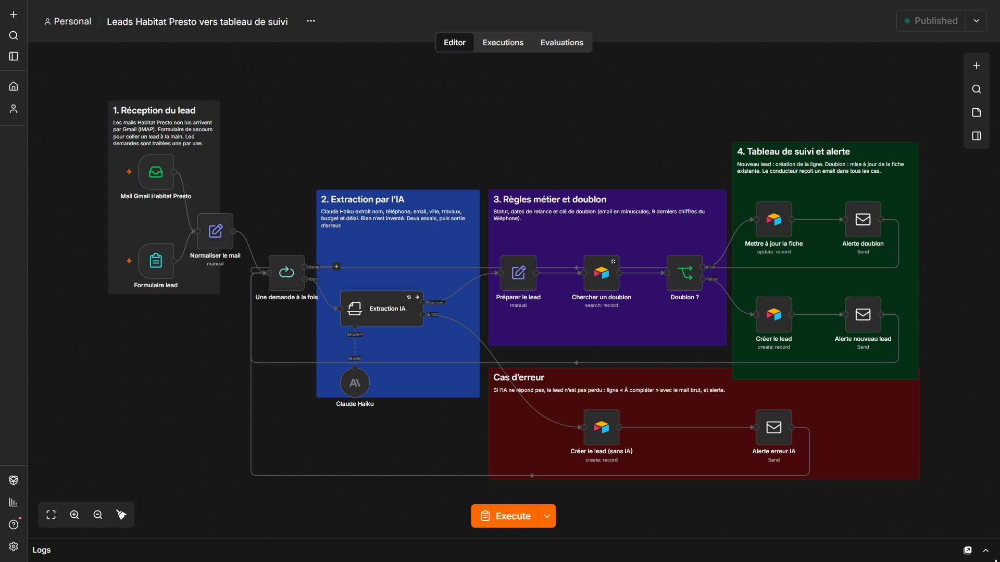

### Les règles appliquées

| Règle | Détail |
|---|---|
| État « Nouveau » | Le nom est connu et il y a au moins un moyen de contact (email ou téléphone) |
| État « À compléter » | Dans tous les autres cas, avec la raison dans le commentaire |
| Téléphone | Mis au format +33 |
| Client déjà connu | Même email (majuscules ignorées) ou mêmes 9 derniers chiffres de téléphone |
| Date de rappel | Réception + 2 jours (+ 1 jour à chaque nouveau contact d'un client connu) |
| Fiabilité de la lecture | Consigne « n'invente rien », réglage stable d'une fois sur l'autre, contrôle des résultats par des règles simples |
| Dates et heures | Format JJ/MM/AAAA, 24 h, fuseau Europe/Paris dans Airtable et dans n8n |

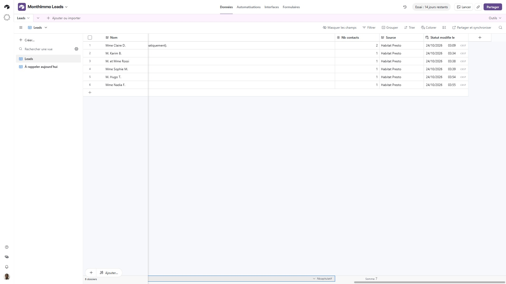

### Installation

Il faut n8n (version 2), un compte Airtable, un compte Gmail avec un mot de passe d'application et une clé d'accès Anthropic.

1. Dans Airtable, créer une base avec une table `Leads` portant les champs : Nom, Telephone, Email, Ville, Type de travaux, Budget min, Budget max, Delai, Statut (Nouveau, À compléter, Appelé, RDV pris, Devis envoyé, Gagné, Perdu), Responsable, Date reception, Date de relance, Commentaire, Nb contacts, Source, Statut modifie le. Créer aussi un jeton d'accès personnel.
2. Dans n8n, importer [Leads_HabitatPresto_n8n.json](workflow/Leads_HabitatPresto_n8n.json). L'export ne contient aucun identifiant.
3. Créer les accès : lecture Gmail, envoi Gmail, Airtable, Anthropic.
4. Adapter l'identifiant de la base Airtable dans les trois étapes Airtable, et l'adresse du destinataire dans les trois étapes d'alerte.
5. Publier le workflow, puis envoyer un email d'objet `Nouveau lead Habitat Presto` à la boîte lue. Le texte peut venir de [leads_test.txt](leads_test.txt). Sans Gmail, le formulaire de secours accepte un texte collé à la main.

### Sécurité

- Aucune clé, mot de passe ou jeton dans ce dépôt.
- Les accès créés pour ce cas pratique (mots de passe d'application Google, clé Anthropic, jeton Airtable) sont dédiés et seront révoqués après l'entretien.
- Toutes les données (noms, numéros, adresses) sont fictives.

</details>

## 7. Contenu du dépôt

```text
.
├── README.md
├── leads_test.txt                      5 demandes fictives pour essayer l'outil
├── workflow/
│   └── Leads_HabitatPresto_n8n.json    l'outil exporté, sans aucun secret
├── note/
│   ├── Note_Adoption_Mesure_Cedric_Kouadio.pdf   la note d'une page
│   ├── build_note.py                   génération de la note
│   └── assets/                         logo et police de la note
└── captures/                           10 captures d'écran réalisées sur ce projet
```

## Auteur

**Cédric Kouadio**, étudiant en Master IA et Big Data à l'ESGI.

[GitHub](https://github.com/GomuGomuNo01)
